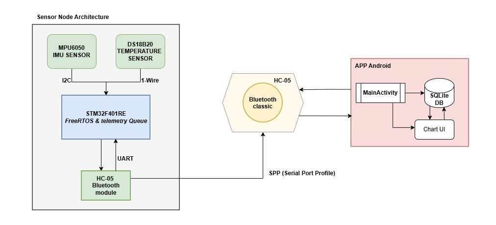
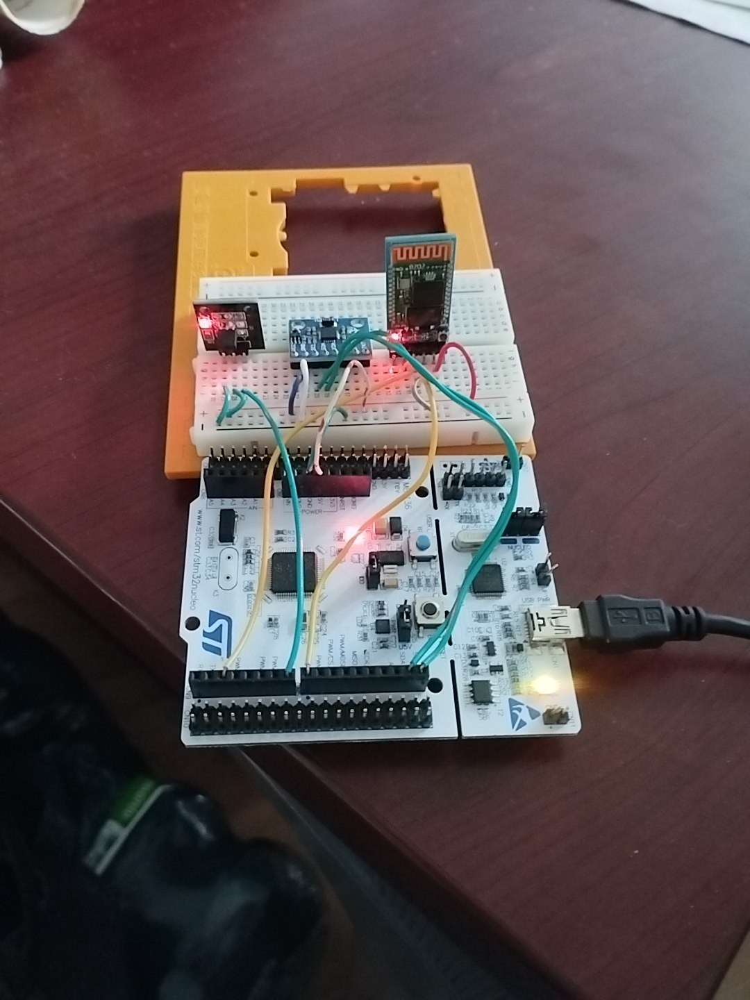

# Distributed Monitoring System

**STM32-based telemetry node with Bluetooth communication and an Android application for local sensor monitoring.**

## Overview

The project uses an **STM32F401RE** running **FreeRTOS** to acquire data from an **MPU6050 accelerometer** and a **DS18B20 temperature sensor**.

Measurements are sent through an **HC-05 Bluetooth module** to an Android application, which displays live data and stores records locally in **SQLite**.

No cellular connection or cloud broker is required for local monitoring.

## System Architecture

  

The STM32 acquires and processes sensor data, then forwards telemetry through Bluetooth Classic to the Android application for live monitoring and local storage.

## Hardware Prototype

  

The prototype is built around the **NUCLEO-F401RE** board, with the sensors and HC-05 module connected through a breadboard.

## Hardware Configuration

| Component | Function | STM32 Connection |
|---|---|---|
| **MPU6050** | 3-axis acceleration | I2C1: PB8 (SCL), PB9 (SDA) |
| **DS18B20** | Digital temperature | PA8: software 1-Wire GPIO |
| **HC-05** | Bluetooth Classic SPP | USART1: PA9 (TX), PA10 (RX) |

The HC-05 serial connection is configured for **9600 bit/s, 8-N-1**. A common ground is required. The DS18B20 1-Wire data line uses a pull-up resistor (typically 4.7 kΩ).

## Firmware and Data Flow

- **FreeRTOS** separates sensor acquisition and UART transmission into two tasks.
- **MPU6050:** acceleration data is smoothed using a moving average with circular buffers of up to 32 samples per axis.
- **DS18B20:** software 1-Wire communication with DWT-based timing.
- **Telemetry queue:** stores up to 10 packets; a packet is generated every 100 sensor-task iterations.
- **Bluetooth:** the HC-05 forwards UART data to Android using Bluetooth Classic SPP.
- **Android application:** parses incoming records, displays live measurements and stores them in a local SQLite database.

## Possible Improvements

CRC validation, explicit sensor configuration, improved queue and UART error handling, timing instrumentation, Bluetooth reconnection and enhanced Android data management.
